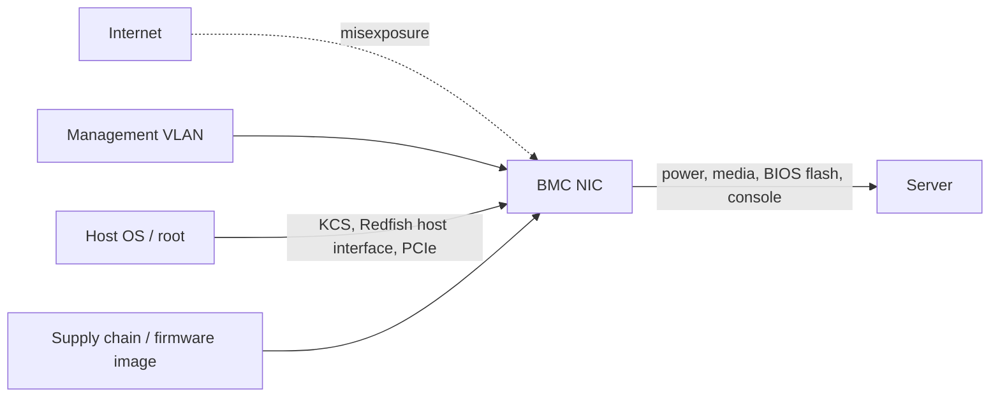

# The Management Plane Beneath the OS: Problem and Threat Model

Almost every server in a data centre contains a second computer. The baseboard management controller (BMC) is a small system-on-chip on the motherboard with its own processor, memory, flash, operating system and network interface. It can power the server on and off, mount virtual media, show the console, read sensors, update BIOS and, on many platforms, read and write host memory over buses such as PCIe or LPC. It runs whenever the server has standby power, even when the host is off. Whoever controls the BMC controls the server, below anything the host operating system can see or enforce.

This book is about that management plane: how it works, how it has been attacked according to public research, and how to run it safely.

## Why it is a high-value target

Matrosov, Rodionov and Bratus's *Rootkits and Bootkits* (No Starch Press, 2019) puts it directly: BMC chips from Intel, Dell, HP and others are "based primarily on ARM microcontrollers with integrated network interfaces and flash storage" running a real-time or embedded OS with applications such as a web server listening on a separate management interface, and "if you've been reading attentively, this should scream 'attack surface!'". The authors draw the general lesson that "the overall measure of a platform's attack surface is its communication boundary": a separate CPU does not help if its firmware exposes a rich, C-written web server or accepts unauthenticated update images.

The CISA and NSA joint information sheet "Harden Baseboard Management Controllers" (June 2023) makes the same point for defenders: BMCs are trusted components that run separately from the OS, credentials and firmware updates are often neglected, and an attacker controlling a BMC could disable protections such as TPM-based measurement and UEFI Secure Boot, manipulate attached storage, or spread implants.

Three properties combine to make compromise severe:

| Property | Consequence |
|---|---|
| Runs independently of host OS | Host EDR, firewalls and logs do not see BMC activity |
| Privileged access to host hardware | Can reflash BIOS, mount media, sometimes read host memory |
| Separate firmware update path | Often patched late or never; implants survive OS reinstall |

Public cases illustrate each one. Microsoft reported in 2017 that the PLATINUM group used Intel AMT Serial-over-LAN, a management channel independent of the OS, to communicate invisibly to host firewalls (summarised in *Rootkits and Bootkits*). In 2021 the Iranian firm Amnpardaz reported "iLOBleed", malware implanted in HPE iLO firmware that, according to its report, survived OS reinstallation, faked firmware upgrades in the web UI and was used in data-wiping incidents. In 2025 CISA added CVE-2024-54085, an authentication bypass in AMI MegaRAC SPx firmware reachable through the Redfish interface, to its Known Exploited Vulnerabilities catalogue; Eclypsium, which reported the flaw, described it as the first BMC vulnerability listed in KEV.

## Components in scope

- **BMC hardware:** commonly ASPEED AST2400/2500/2600 SoCs on x86 servers; vendor-specific silicon in some platforms.
- **BMC firmware:** vendor stacks (Dell iDRAC, HPE iLO, Lenovo XClarity Controller, Supermicro), third-party stacks (AMI MegaRAC) and the open-source OpenBMC project.
- **Protocols:** IPMI over LAN (RMCP+, UDP 623), Redfish (REST over HTTPS), legacy WS-Management, SSH, web UI, KVM-over-IP and virtual media, SNMP.
- **Host interfaces:** KCS/BT IPMI interfaces, Redfish Host Interface over a virtual USB NIC, PCIe and LPC bridges.
- **Intel ME / AMD PSP:** related but distinct management engines inside the host chipset; covered where they interact.

## Threat model

| Attacker | Starting point | Typical goal |
|---|---|---|
| External | BMC reachable from the internet | Initial access, ransomware, wiping |
| Internal network | Foothold on management or flat network | Lateral movement to every server via shared BMC credentials |
| Host root | Compromised OS on the server | Persistence below the OS via host-to-BMC interfaces |
| Supply chain | Firmware build, distribution, refurbished hardware | Pre-installed implants |
| Insider / hosting provider | Legitimate BMC access | Data theft, key extraction from colocation hosts |

The last row matters for anyone renting dedicated servers: the hosting provider's staff and tooling have BMC access to your machine. For node and validator operators, see **validator-operations-security**.

## Rules for this book

Test only BMCs you own or administer under written authorisation. Do not scan the internet for BMCs or attempt logins to devices you do not control; even "checking" default credentials on someone else's equipment is unauthorised access in many jurisdictions. Report vulnerabilities to the vendor's PSIRT and follow coordinated disclosure.

## Worked example

*Execution status: not executed in this book's CI; verify locally.*

Inventory your own management plane.

1. List every server you operate and record the BMC vendor, model, firmware version and the IP of its management interface (from your asset system or the host with `sudo ipmitool lan print 1` and `sudo ipmitool mc info`).
2. From the host, check whether a Redfish Host Interface is present (`ip link` showing a USB-attached NIC, or `dmidecode -t 42`).
3. Note which network each BMC interface is on and whether it is shared with the host NIC ("shared LOM") or dedicated.
4. Record who has BMC accounts and whether any accounts share passwords across servers.
5. Compare firmware versions with the vendor's current advisories.

## Common pitfalls

- Treating BMCs as "hardware" outside the patch programme.
- Shared-LOM configurations that put the BMC on the production network without anyone noticing.
- One BMC password across the whole fleet.
- Forgetting that the host OS can talk to the BMC without network credentials on many platforms.
- Assuming a rented dedicated server's BMC is invisible to the provider.

## Exercises

1. Draw your management-plane data flows using the diagram above and mark every path that does not require authentication.
2. Map the five attacker types in the table to the controls you already have.
3. Read the CISA/NSA BMC information sheet and list which recommendations you already meet.

## Further reading

- A. Matrosov, E. Rodionov, S. Bratus, *Rootkits and Bootkits* (No Starch Press, 2019), "Case Studies: Attacks on Intel AMT and BMC"
- CISA and NSA, "Harden Baseboard Management Controllers" (June 2023): <https://www.cisa.gov/news-events/alerts/2023/06/14/cisa-and-nsa-release-joint-guidance-hardening-baseboard-management-controllers-bmcs>
- NVD entry for CVE-2024-54085: <https://nvd.nist.gov/vuln/detail/CVE-2024-54085>
- The Record, coverage of the iLOBleed report: <https://therecord.media/threat-actor-uses-hp-ilo-rootkit-to-wipe-servers/>
- Related books: **validator-operations-security**, **firmware-fuzzing-llm-peripherals**
