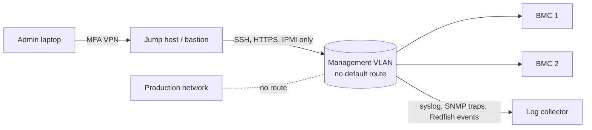

# Network Isolation, Hardening and Monitoring

Most BMC compromises in public reporting start with reachability: an interface on the internet, on a flat corporate network, or reachable from a compromised host. This chapter covers how to isolate the management plane, harden each BMC, and monitor it so that misuse is noticed. The structure follows the CISA and NSA "Harden Baseboard Management Controllers" information sheet (June 2023), which recommends changing default credentials, restricting BMC access to an administrative VLAN, checking for BMC firmware updates routinely because they are delivered separately from other updates, and monitoring BMC integrity.

## Network isolation

The 2014 "Applied Crypto Hardening" guide from the bettercrypto.org project gave advice that remains correct: never connect ILO, iDRAC or IPMI-based management systems to the public internet; create an unrouted management VLAN and reach it only through a VPN.

A modern design:



| Control | Detail |
|---|---|
| Dedicated BMC port | Avoid shared-LOM; if unavoidable, tag BMC traffic onto a separate VLAN and verify host cannot bridge it |
| No internet route | Management VLAN has no default gateway, or egress only to named update and NTP servers |
| Access via bastion | All admin access through jump hosts with MFA and session recording |
| Inter-BMC filtering | Private VLANs or ACLs so a compromised BMC cannot attack its neighbours |
| Inbound only from bastion | ACLs allow management ports only from jump hosts and monitoring |
| Host-side restriction | Disable Redfish Host Interface and in-band IPMI where not needed, or restrict with OS policy |

Isolation comes first because it is the one control that does not depend on the BMC firmware being correct. Authentication bypasses such as CVE-2017-12542 and CVE-2024-54085 made passwords irrelevant on affected devices; only devices an attacker could not reach were safe until patches arrived. Shared-LOM ports deserve particular attention, because the BMC then sits on the same physical cable as production traffic and a VLAN misconfiguration on the switch silently exposes it. Time synchronisation also matters: give BMCs an internal NTP source so their logs line up with the rest of your telemetry during an investigation.

Check exposure from outside: your own external attack-surface scans, plus searching your address ranges in internet-scan services, should never show BMC services. Do not scan address ranges you do not own.

## Account and authentication hardening

- Unique random password per BMC, stored in a secrets manager and rotated; no shared fleet password.
- Integrate with directory services (LDAP/Active Directory) or RADIUS where supported, with MFA if available, so access can be revoked centrally. Keep one local break-glass account in the vault.
- Remove or disable default and anonymous accounts.
- Least privilege: ReadOnly roles for monitoring, Operator for power control, Administrator only for firmware and accounts.
- Enable account lockout and login rate limiting.
- Replace self-signed certificates with certificates from an internal CA, and disable TLS 1.0/1.1 and weak ciphers.

## Service reduction

Disable everything not needed: IPMI over LAN (or restrict cipher suites per Chapter 3), SNMP v1/v2c (use v3 if SNMP is required), Telnet, legacy WS-Man, unencrypted HTTP, virtual media when not in use, SSDP/discovery protocols, and the Redfish Host Interface if the OS does not need it. Re-check after firmware updates, which can reset settings.

## Firmware management

- Track BMC firmware in your asset inventory and patch system, with a target SLA for critical advisories (for example, KEV-listed issues within days).
- Enable signature enforcement and anti-rollback if offered.
- Prefer platforms with a hardware root of trust that verifies BMC firmware at boot.
- Subscribe to OEM PSIRT advisories and to advisories from the upstream firmware vendor (AMI, OpenBMC).
- Verify updates out of band where possible: compare version and hash via a path independent of the BMC's own UI.

## Monitoring

| Signal | Source | Why |
|---|---|---|
| Logins, failed logins, new accounts, role changes | BMC audit log via syslog or Redfish events | Credential attacks, persistence |
| Firmware update events | BMC log, Redfish `UpdateService`, OEM tooling | Unauthorised flash |
| Virtual media mount, KVM session start | BMC log | Interactive misuse |
| Power and boot-order changes | SEL, Redfish `Systems` | Boot from attacker media |
| Configuration drift | Periodic Redfish export compared with baseline | Settings re-enabled |
| Network flows to/from BMC VLAN | Firewall and flow logs | BMC talking to unexpected hosts |
| Host-side BMC access | Host audit of `/dev/ipmi*`, Redfish host interface traffic | Host-to-BMC attacks |

Redfish event subscriptions (`/redfish/v1/EventService/Subscriptions`) and remote syslog are the main export paths. Ship logs immediately; a compromised BMC can erase its own log. Correlate with the hypervisor or host: a power cycle or boot from virtual media with no change ticket is an incident.

## Worked example

*Execution status: not executed in this book's CI; verify locally.*

Harden and baseline one BMC you administer.

1. Export the current configuration over Redfish: query `/redfish/v1/Managers/<id>`, `/NetworkProtocol`, `/AccountService/Accounts` and save JSON with a timestamp.
2. Disable unneeded protocols with a Redfish `PATCH` to `NetworkProtocol` (for example `{"IPMI": {"ProtocolEnabled": false}}`), following your vendor's documentation for supported properties.
3. Configure remote syslog to your collector and create a Redfish event subscription for your monitoring endpoint.
4. From a host outside the management VLAN, confirm that BMC ports are unreachable (`nmap -Pn -p 22,80,443,623 <bmc-ip>` should show filtered).
5. Schedule a daily job that re-exports the configuration and diffs it against the saved baseline, alerting on change.

```bash
curl -sk -u "$U:$P" -X PATCH -H 'Content-Type: application/json' \
  -d '{"IPMI":{"ProtocolEnabled":false},"SSDP":{"ProtocolEnabled":false}}' \
  https://<bmc-ip>/redfish/v1/Managers/<id>/NetworkProtocol
```

## Common pitfalls

- Management VLANs that quietly gained a default route for "updates".
- Monitoring that relies on the BMC's local log only.
- Firmware updates that re-enable IPMI, SSDP or default accounts.
- Allowing BMCs to talk to each other freely, so one compromise spreads.
- Directory integration with no local break-glass account, locking you out during an outage.

## Exercises

1. Write firewall rules for a management VLAN that allow only bastion-to-BMC management, BMC-to-collector logging, and BMC-to-NTP.
2. Build a Redfish configuration-drift checker for all your BMCs and run it after the next firmware update.
3. Create SIEM detections for BMC account creation, firmware update and virtual-media mount, and test each on a lab BMC.

## Further reading

- CISA and NSA, "Harden Baseboard Management Controllers" (2023): <https://www.nsa.gov/Press-Room/Press-Releases-Statements/Press-Release-View/Article/3426648/nsa-and-cisa-release-guide-to-protect-baseboard-management-controllers/>
- bettercrypto.org, *Applied Crypto Hardening* (2014), section "IPMI, ILO and other lights out management solutions"
- DMTF Redfish specification: <https://www.dmtf.org/standards/redfish>
- Related books: **validator-operations-security**, **blockchain-rpc-node-security**
